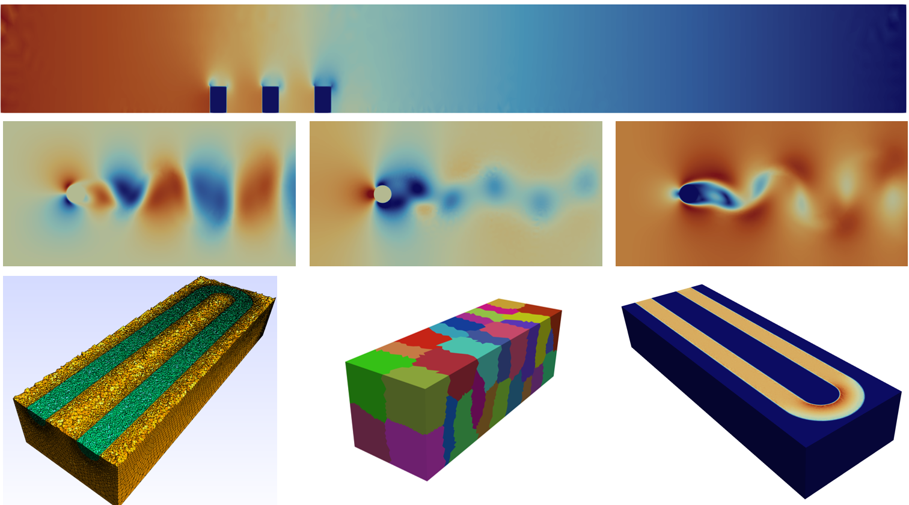

<div align="center">


<br>

[Documentation](docs/index.md) · [Quick start](docs/getting-started/quickstart.md) · [Validation](docs/validation/index.md) · [Development status](docs/parallel/status.md) · [Contributing](CONTRIBUTING.md)

</div>

---

## Overview

**CBS3D++** is a modern C++20 finite-element solver for three-dimensional
incompressible fluid dynamics. It is based on the semi-implicit
**Characteristic-Based Split (CBS)** formulation and is being developed for
research-scale laminar flow, turbulence modelling, conjugate heat transfer and
broader multiphysics applications.



The project modernises a legacy Fortran CBSFlow development while preserving
the numerical method, finite-element conventions and benchmark lineage. The
new implementation introduces modular C++ architecture, reproducible build
systems, OpenMP acceleration, PETSc pressure-solver integration, distributed
mesh infrastructure and modern VTU/PVD output.

> [!IMPORTANT]
> The validated production path is currently the **serial/PETSc or OpenMP
> shared-memory solver**. Distributed mesh ownership, halo exchange and MPI
> solver integration are under active development. Fully distributed numerical
> acceleration is not yet claimed as a released capability.

## Current capabilities

| Capability | Status |
|---|---|
| Three-dimensional incompressible Navier–Stokes equations | Available |
| Semi-implicit four-stage CBS velocity-correction scheme | Available |
| Linear P1 tetrahedral finite elements | Available |
| Laminar steady/pseudo-transient flow | Available |
| Conjugate heat transfer and scalar energy transport | Development path available |
| Spalart–Allmaras turbulence model | Active development and validation |
| Native matrix-free preconditioned conjugate gradient | Available |
| PETSc KSP/GAMG pressure solve | Available in the serial/OpenMP path; HYPRE optional when built |
| OpenMP element assembly | Available |
| MPI mesh distribution, ownership and halo infrastructure | Active development |
| Fully distributed CBS Steps 1–4 | Not yet production-ready |
| ParaView VTU/PVD output and residual histories | Available |

Detailed limitations and development gates are recorded in the
[parallelisation status](docs/parallel/status.md) and the internal solver audit
under `docs/`.

## Consolidated master status

This tree is the consolidated master at `C:\PhD\CFD\CBS3D_MASTER`, based on the
local `integration/sa-mpi` branch. It includes the SA-neg work that was developed
locally (`e4038b7`, `1e3663d`) plus the corrected flat-plate setup, serial Gmsh
converter, native-CG baseline and PETSc/AMG workflow.

Recent local results:

- `11/11` serial verification tests pass under both the MSVC and MSYS2 presets.
- The corrected 284,400-tet flat plate runs stably with fixed `dt=1.0e-5`.
- The refined 1,235,520-tet flat plate requires local pseudo-time stepping
  (`ilots=1`, `dtfixed=0`); its first-cell SA diffusive limit is about `5.3e-6`,
  below the fixed `1.0e-5` step.
- Corrected and refined LTS runs both complete 200 iterations without an SA
  ceiling failure; see [docs/MESH_STUDY.md](docs/MESH_STUDY.md).

## Numerical formulation

The active solver uses a pressure-projection form of the Characteristic-Based
Split method:

1. **Momentum predictor:** compute a pressure-free intermediate velocity.
2. **Pressure solve:** assemble and solve the pressure-Poisson system.
3. **Velocity correction:** apply the pressure-gradient correction.
4. **Energy/scalar update:** advance temperature or the active transported scalar.

The spatial discretisation uses linear tetrahedral elements with element-wise
constant shape-function gradients and lumped nodal mass terms. See the
[numerical formulation](docs/numerics/formulation.md) for the governing
equations, discrete assumptions and implementation scope.

## Build

### Requirements

- C++20 compiler
- CMake 3.16 or newer
- OpenMP implementation for threaded builds
- MPI implementation for the distributed-development build
- PETSc with a compatible compiler/MPI toolchain for the PETSc pressure path

### CMake: serial/OpenMP reference build

```bash
cmake -S . -B build \
  -DCMAKE_BUILD_TYPE=Release \
  -DCBS3D_ENABLE_OPENMP=ON \
  -DCBS3D_ENABLE_MPI=OFF \
  -DCBS3D_ENABLE_PETSC=OFF

cmake --build build -j
```

### Local Windows presets

```powershell
# MSVC serial/OpenMP
cmake --preset tests-msvc-release
cmake --build --preset build-tests-msvc-release
ctest --preset test-tests-msvc-release

# MSYS2 UCRT64 PETSc/GAMG
cmake --preset local-msys2-petsc
cmake --build --preset build-local-msys2-petsc
```

The MSYS2 PETSc runtime needs `C:\msys64\ucrt64\bin` on `PATH`. See
[docs/LOCAL_TOWER.md](docs/LOCAL_TOWER.md) for the full local workflow and
measured timings.

## Run a case

A case is identified by a common base name. Depending on the selected physics,
the solver reads:

```text
<case>.plt
<case>.bco
<case>.par
<case>.material    # material-enabled cases
<case>.matprop     # material-enabled cases
```

Typical execution:

```bash
./cbs3dpp_si path/to/case_name
```

Local corrected flat plate:

```powershell
Set-Location cases\flat_plate_local
..\..\build\local-serial-openmp\Release\cbs3dpp_si.exe flat_plate_local
```

PETSc/AMG flat plate:

```powershell
$env:PATH = "C:\msys64\ucrt64\bin;$env:PATH"
$env:OMP_NUM_THREADS = "20"
Set-Location cases\flat_plate_petsc
..\..\build\local-msys2-petsc\cbs3dpp_si.exe flat_plate_petsc
```

Start with the [quick-start guide](docs/getting-started/quickstart.md). The
complete file contract is described in [case files](docs/user-guide/case-files.md).

## Validation strategy

CBS3D++ validation is organised into four evidence classes:

1. **Legacy regression:** C++ results are compared against the corresponding
   legacy Fortran implementation on matched meshes, parameters and boundary
   conditions.
2. **Independent benchmarks:** results are compared with analytical,
   experimental or published reference data.
3. **Discretisation verification:** mesh, time-step and solver-tolerance
   sensitivity are quantified.
4. **Parallel verification:** distributed results must reproduce the accepted
   serial solution before scalability is reported.

Current and planned cases include:

- lid-driven cavity;
- internal/channel flow;
- flow around a cylinder;
- conjugate heat-transfer configurations;
- Spalart–Allmaras flat-plate boundary layer;
- strong- and weak-scaling studies after the distributed solver is complete.

See the [validation programme](docs/validation/index.md) and
[legacy-regression protocol](docs/validation/legacy-regression.md).

## Project lineage

CBS3D++ is a new C++ implementation derived from the numerical and operational
lineage of the legacy **CBSFlow 3D** finite-element solver. The public Zeta
Computational Resources material describes CBSFlow 3D as an incompressible
Navier–Stokes finite-element solver using characteristic-based split convection
stabilisation and a fractional-step solution procedure.

This repository does **not** treat the legacy source as redistributable
material. Zeta states that its source code is copyrighted and may not be
redistributed without written permission. The public project therefore
documents provenance and numerical equivalence while keeping licensing
boundaries explicit.

- [CBSFlow 3D description](https://www.zetacomp.com/software/cbsflow3d.asp)
- [Zeta software terms](https://www.zetacomp.com/software.asp)
- [Zeta 3D benchmark data](https://www.zetacomp.com/benchmarks/benchmarks3d.asp)
- O. C. Zienkiewicz, R. L. Taylor and P. Nithiarasu, *The Finite Element Method
  for Fluid Dynamics*, 7th edition.

The full provenance statement is maintained in
[legacy provenance](docs/legacy/provenance.md).

## Repository structure

```text
apps/            serial and parallel entry points
include/cbs/     public solver headers
src/             solver, assemblies, turbulence, I/O, linear algebra
tests/           verification and regression programs
cases/           local flat-plate cases
examples/        redistributable public examples
tools/           mesh validation, conversion and diagnostics
jobs/            Sunbird Slurm jobs
docs/            numerical, user, validation, master and tower documentation
.github/         continuous integration and repository templates
```

## Documentation

The documentation is intentionally separated from this landing page:

- [Documentation index](docs/index.md)
- [Master consolidation and build matrix](docs/MASTER.md)
- [Local 20-core tower workflow](docs/LOCAL_TOWER.md)
- [Mesh format and Gmsh conversion](docs/MESH_FORMAT.md)
- [Flat-plate mesh study](docs/MESH_STUDY.md)
- [SA/SA-neg development status](docs/SA_DEVELOPMENT.md)
- [Installation](docs/getting-started/installation.md)
- [Quick start](docs/getting-started/quickstart.md)
- [Case-file reference](docs/user-guide/case-files.md)
- [Numerical formulation](docs/numerics/formulation.md)
- [Parallelisation status](docs/parallel/status.md)
- [Validation programme](docs/validation/index.md)
- [Legacy provenance](docs/legacy/provenance.md)
- [Sunbird HPC workflow](docs/hpc/sunbird.md)
- [Troubleshooting](docs/troubleshooting.md)

The same Markdown tree is configured for a future MkDocs documentation website.

## Contributing and citation

Development contributions should preserve numerical behaviour, document changed
equations and assumptions, and include an appropriate regression case. Read
[CONTRIBUTING.md](CONTRIBUTING.md) before opening a pull request.

Citation metadata is supplied in [`CITATION.cff`](CITATION.cff). A permanent
release DOI will be added when the first public research release is archived.

## Licence status

An explicit open-source licence has not yet been selected. Until a `LICENSE`
file is added, copyright law applies and no general permission to copy, modify
or redistribute this repository is granted. This will be resolved before the
first formal public release.
